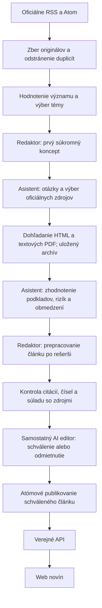

# VEREJNÝ DOHĽAD

Slovenské digitálne noviny, ktoré spracúvajú oficiálne dokumenty o rozhodnutiach štátu a verejných peniazoch. Java 21 Azure Functions zabezpečujú zber, AI redakčný proces a verejné API; React/TypeScript zobrazuje noviny cez Azure Static Web Apps. Dáta a súkromné redakčné podklady sú v jednom Azure Storage Account. Inštalácia projektu nezriaďuje cloudové zdroje.

## Ako noviny fungujú pod kapotou

Článok vzniká cez **prvý koncept → cielenú rešerš → prepracovanie redaktorom → overenie → samostatného AI editora**. Bežná prevádzka s aktivovaným automatickým publikovaním nevyžaduje ľudskú redakčnú prácu. AI kontrola porovnáva text s podkladmi; nedokazuje pravdivosť tvrdení ich vydavateľov.



1. **Zberateľ** načíta oficiálne zdroje, normalizuje text a uloží originál do súkromného Blob úložiska. URL a hash obsahu bránia duplicitám. Starší dokument môže slúžiť ako kontext, nie ako nová správa.
2. **Výber tém** hodnotí verejný záujem, dopad na občanov, význam rozhodnutia a verejné výdavky. Súvisiace nové dokumenty zoskupí a rezervuje denný koncept.
3. **Redaktor** napíše prvý pracovný text. Koncept ešte nie je overený ani verejný.
4. **Rešeršný asistent** z konceptu určí chýbajúcu otázku, najviac dve vyhľadávacie frázy a štyri oficiálne zdroje. Vyberá len ID zo schváleného registra; nevymýšľa URL a neprechádza ľubovoľný web. Pri rozpočte sa musí aspoň pokúsiť dohľadať hodnotenie RRZ.
5. **Dohľadávanie** prehľadá dostupné oficiálne weby a doplní uložený archív. IFP, RRZ a NBS majú cielené vyhľadávanie cez RSS 2.0. Ďalšie konektory používajú oficiálne feedy alebo relevantné odkazy na vstupných stránkach. Čitateľné PDF prílohy môžu vstúpiť do podkladov s označením strán. Nedostupný zdroj či nepodporovaný formát sa zaznamená ako medzera.
6. **Asistent zhodnotí získané podklady** voči konceptu: čo zdroj tvrdí, aké predpoklady a riziká dopĺňa, či je porovnanie vecné a či ide o rovnaké roky, verziu a metodiku. Odovzdá doložené zistenia s presnými úryvkami a obmedzeniami. Nevyriešené hypotézy zostávajú súkromné a redaktor ich nedostáva ako fakty.
7. **Redaktor článok prepracuje** po zhodnotení rešerše. Zachová relevantné pohľady inštitucionálnych skupín zo schválenej rešerše. Jeden odsek môže mať viac citácií, napríklad ministerstvo aj RRZ. MF, IFP a ÚHP sa nepočítajú ako tri nezávislé inštitúcie.
8. **Overovateľ a editor** posúdia výsledný text v oddelených rozhovoroch. Kód kontroluje skutočnú prítomnosť citovaných úryvkov, čísla, citáty a pokrytie odsekov. Samostatný silnejší editor kontroluje aj kontext, titulok, atribúciu a zrozumiteľnosť. Publikovanie vyžaduje úspešné kontroly, výslovné schválenie a neprítomnosť citlivých obvinení.

Pri rozpočte napríklad prvý koncept vychádza zo správy MF. Asistent dohľadá fiškálne hodnotenie RRZ a podklady IFP; overí, či hodnotia rovnaké znenie rozpočtu. Redaktor potom vysvetlí stanovisko ministerstva aj doložené riziká. Staršie hodnotenie návrhu nesmie bez vysvetlenia vydávať za hodnotenie neskôr upraveného schváleného zákona.

| Rola | Predvolené nasadenie modelu | Úloha |
|---|---|---|
| Výber tém | `gpt-4.1-mini` | Význam správy a zoskupenie tém. |
| Redaktor | `gpt-4.1-mini` | Prvý koncept a prepracovanie po rešerši. |
| Rešeršný asistent | `gpt-4.1` | Plán dohľadávania a zhodnotenie získaných dokumentov. |
| Overovateľ | `gpt-4.1-mini` | Samostatné porovnanie výsledného článku so zdrojmi. |
| Hlavný AI editor | `gpt-4.1` | Záverečné rozhodnutie o publikovaní. |

Roly sú oddelené volania modelov, nie otvorené autonómne slučky. HTTP dohľadávanie riadi Java kód. Modely neposielajú e-maily, nekontaktujú subjekty a nemajú priamy prístup k publikovaniu alebo tajným údajom.

### Zdroje a hranice rešerše

Rešeršný register má **30 oficiálnych zdrojov** podľa [katalógu schválených webov](docs/approved-research-websites.md). Presné hosty, inštitucionálne skupiny a stav konektora sú v [research-sites.json](backend/src/main/resources/research-sites.json). Noviny a súkromné médiá v registri nie sú. Zaradenie webu neznamená, že všetky jeho dokumenty boli načítané.

Podporované sú tri vyhľadávacie RSS konektory, oficiálne feedy a obmedzené HTML dohľadávanie. STATdata, Slov-Lex, CRZ, RPVS, RÚZ, ORSR, hlavný štatistický portál a Enviroportál sú označené `UNSUPPORTED`: potrebujú vlastné dátové alebo aplikačné konektory. Asistent takýto výber uvedie ako obmedzenie; nepredstiera, že register preveril. Ani HTML konektor nezaručuje prístup ku všetkým podstránkam či historickému archívu.

Na koncept je najviac **šesť dokumentov**, **65 sekúnd dohľadávania** a **16 HTTP požiadaviek vrátane robots.txt**. Z jedného zdroja vyberá najviac dva výsledky a z jednej stránky najviac jednu PDF prílohu. Dopĺňa aj súvisiace podklady z najviac 100 uložených záznamov za predchádzajúcich 90 dní. Ide o ohraničenú rešerš dostupných relevantných dokumentov, nie garantované zhodnotenie všetkého, čo k téme existuje.

Platí presný HTTPS zoznam hostov, kontrola robots, zákaz presmerovaní a súkromných sietí, 2 MB na odpoveď, osemsekundový timeout a odstup medzi požiadavkami. PDF musí obsahovať extrahovateľný text, mať najviac 60 strán a 50 000 znakov; skeny bez OCR a XLSX sa nepoužívajú ako dôkaz. Neoverený dátum je označený ako neznámy, nie dátumom stiahnutia. Rešeršné dokumenty zostávajú opakovane použiteľným kontextom.

### Limity, checkpointy a publikovanie

Predvolené limity sú **6 konceptov, 3 publikácie a 40 pokusov o AI volanie denne**. Zahŕňajú opravy, odmietnuté a prerušené pokusy; publikácie sa počítajú podľa skutočného dátumu v Bratislave a zahŕňajú aj ručné publikovanie. Sú to maximá, nie záruka konkrétneho počtu článkov. Úplný nový článok obvykle potrebuje päť volaní pred editorom a jedno záverečné posúdenie; dávkované hodnotenie tém je navyše. Editor dostáva dokončené články priebežne, aby ďalšie rešerše neminuli všetky volania pred publikovaním.

**Ad hoc beh má samostatný rozpočet a nečerpá denné limity.** Používa rovnaké nastavené stropy (predvolene 6 konceptov / 3 publikácie / 40 AI volaní) na konkrétny manuálny beh. Jeho publikácie neznižujú ranný publikačný limit a môže bežať aj po vyčerpaní dnešného rozpočtu. Každý beh má UUID; opakovanie rovnakého UUID zachová jeho počítadlá a checkpointy. Nové UUID znamená nový samostatný rozpočet. Deduplikácia, globálny lease, overenie a AI editor platia ďalej. Platené AI volania sa stále účtujú; doterajšie denné počty sa spätne nemažú ani nepresúvajú.

Manuálne spustenie používa existujúci Azure admin endpoint `POST /admin/functions/MorningEdition` s `_master` kľúčom v `x-functions-key` a telom `{"input":"adhoc:UUID"}` (alebo `{"input":"adhoc"}` pre automatické UUID). CLI `editorial.ps1 run` je tiež ad hoc; voliteľný UUID argument obnoví ten istý beh. Výsledky/logy obsahujú `scope: adhoc|UUID`; úložisko má `Sources.ops` kľúč `budget|adhoc|UUID`. Bežný timer zostáva na `budget|YYYY-MM-DD`. Presný PowerShell postup je v [redakčnom návode](docs/editorial-workflow.md#ad-hoc-run-outside-daily-limits).

Prvý koncept, plán, výsledok dohľadávania, rešerš a prepracovaný text majú súkromné nemenné checkpointy v `articles/assistant/{articleId}/{inputHash}/`. Po prerušení sa hotové fázy znovu nepýtajú modelu ani neprehľadávajú web. Hash viaže zdroje, modely, politiku a register. Pád medzi prijatím AI požiadavky a uložením odpovede môže stále zopakovať platený pokus; denná rezervácia sa zachová.

Publikovanie používa spoločný obnovovaný Blob lease a atómovú Table transakciu pre súkromné metadáta aj verejné indexy. Rozpracované články a rešerše nie sú verejné. Staršie rozpracované články dokončia pôvodný proces; nové začínajú rešeršným flow. Zverejnené články sa automaticky neprepisujú.

`RESEARCH_FLOW_ENABLED` je predvolene `true` v Azure režime a `false` v offline mock režime. Dá sa výslovne vypnúť. Staršie App Settings 8/5 sa pri novom kóde bezpečne obmedzia na 6/3; pri nasadení ich nastaviť výslovne na nové hodnoty podľa [deployment návodu](docs/deployment.md). Denné ledger záznamy sa nemažú ani neresetujú. Existujúci backend treba aktualizovať, aby nový flow bežal v produkcii.

## Local setup

Prerequisites: Java 21, Maven 3.9+, Node.js 22 LTS, Azure Functions Core Tools **v4** (`func` on PATH). Azure CLI is needed only for production RBAC or Bicep validation. Install Core Tools using [Microsoft's official instructions](https://learn.microsoft.com/azure/azure-functions/functions-run-local). The repository uses portable local tooling for development where available; `.tools/` is ignored.

```powershell
npm ci
npm --prefix frontend ci
Copy-Item backend/local.settings.json.example backend/local.settings.json
Copy-Item frontend/.env.example frontend/.env
npx playwright install chromium
```

Open three terminals from the repository root:

```powershell
# Terminal 1: keep the single local Storage emulator running
npm run storage

# Terminal 2: provision local containers/tables, then run Java Functions
./scripts/setup-storage/setup-storage.ps1
./scripts/start-backend.ps1

# Terminal 3: Vite proxies /api to localhost:7071
npm run frontend
```

Visit **http://localhost:5173**. An empty edition is intentional until an approved article is published. APIs: `http://localhost:7071/api/articles`, `/api/articles/{slug}`, `/api/editions/latest`. Drafts and storage blobs are private. For unattended production, activate [the automatic AI editor](docs/deployment.md#activate-the-automatic-ai-editor): `gpt-4.1-mini` writes, a separate configurable `gpt-4.1` deployment decides publication. No routine human review is needed; failed or sensitive articles stay unpublished. Automatic publication is disabled until explicitly configured.

The default `AI_MODE=mock` makes **zero paid AI calls**. It assigns real material a score of zero; only explicitly marked synthetic fixtures generate offline drafts. No fake news is seeded on startup. Create an optional local fixture to exercise review/publishing:

```powershell
./scripts/editorial/editorial.ps1 fixture
./scripts/editorial/editorial.ps1 -SkipBuild list
./scripts/editorial/editorial.ps1 -SkipBuild inspect ARTICLE_ID
./scripts/editorial/editorial.ps1 -SkipBuild approve ARTICLE_ID 'Local test editor'
./scripts/editorial/editorial.ps1 -SkipBuild publish ARTICLE_ID
```

The fixture is prominently marked `[SYNTHETIC]`, and CLI fixture creation/publication is restricted to `UseDevelopmentStorage=true`. Its `example.invalid` source is explicitly synthetic and deliberately not a real document; actual articles receive the original government URLs.

## Collecting real sources and using Azure AI

```powershell
# Public source connectivity/body checks only; no Storage or AI needed
./scripts/editorial/editorial.ps1 check-feeds
# Download real originals into Azurite, without AI
./scripts/editorial/editorial.ps1 -SkipBuild collect
```

Verified on 13 October 2026: Úrad vlády SR, MF SR, MH SR, NKÚ SR, Rada pre rozpočtovú zodpovednosť and Národná banka Slovenska. MV SR remains disabled without an established suitable endpoint. See [source verification](docs/sources.md) and the configurable [registry](backend/src/main/resources/sources.json).

Daily defaults allow **6 concept attempts and at most 3 published articles**, with 40 considered source documents and 40 attempted AI calls. Rejected drafts consume a concept attempt, not a publication slot. Accepted drafts waiting beyond the publication cap stay private for the next day. New Azure concepts use the assistant flow above; an analytical comparison requires evidence from distinct institutional groups. Private unanswered leads never reach the writer. See [editorial workflow](docs/editorial-workflow.md).

To use the configured Azure deployment, set `AI_MODE=azure`, `AZURE_OPENAI_ENDPOINT` and `AZURE_OPENAI_DEPLOYMENT` in your ignored settings or environment. Prefer `az login` and **Cognitive Services OpenAI User** RBAC; an optional `AZURE_OPENAI_API_KEY` is supported for local development. Then `editorial.ps1 run` performs the morning pipeline. This step can incur model charges and is never run by offline tests. No paid calls were required to develop this repository.

Timer: `0 0 3 * * *` means **03:00 UTC**, **04:00 CET / 05:00 CEST**. Collection has a two-minute budget; pipeline has an eight-minute budget within the Consumption host's ten-minute timeout. A numerical citation error in a preliminary rejection can create one audited correction concept that must pass fresh verification and final review; the parent remains rejected, and there is no correction chain. Context documents remain reusable for other topics. Outages, unavailable fresh source material and failed checks may delay or prevent an edition; there is no guaranteed completion SLA. Ad hoc execution uses the authenticated Azure platform admin API or the local RBAC CLI, with an independent per-run budget.

## Tests and builds

```powershell
mvn -B -f backend/pom.xml verify
npm --prefix frontend test
npm --prefix frontend run build
npx playwright test
# Start Azurite first; explicitly opt in to local Storage integration
mvn -f backend/pom.xml -Dtest=AzureStoreIT -Dstorage.integration=true test
# Compile templates only; does not deploy
az bicep build --file infrastructure/main.bicep --outfile .local/main.json
az bicep build --file infrastructure/openai.bicep --outfile .local/openai.json
```

Tests use clearly marked synthetic releases and mock AI. Browser tests check both desktop and mobile, navigation, article URLs, loading/error states and Markdown sanitization. Storage integration tests exercise real Azure SDK operations against Azurite, including duplicate transactions, ETags, leases and publication indexes. See [verification notes](docs/verification.md).

The new backend tests also cover stage order, cached research after interruption, multiple citations, institutional independence, public-source failures and model routing. An optional live connector check uses only public RRZ/IFP websites, with no AI calls or production Storage writes:

```powershell
mvn -f backend/pom.xml -Dtest=OfficialResearchLiveIT -Dresearch.integration=true test
```

## Deployment and editorial operations

For GitHub frontend deployment, local npm is unnecessary: the GitHub runner installs Node.js, tests/builds React and uploads to the existing Static Web App. Use the manual **Deploy newspaper frontend** workflow with `FUNCTION_API_URL` and the app's deployment token in the `azure-production` GitHub environment. See [the GitHub deployment steps](docs/deployment.md#deploy-the-frontend-through-github-without-local-npm). The full backend/frontend release workflow additionally uses Azure OIDC.

Follow [deployment](docs/deployment.md), [architecture](docs/architecture.md), and [editorial workflow](docs/editorial-workflow.md). Provisioning and release workflows are **manual** and require an explicit affirmative dispatch input. Configure the `azure-production` GitHub environment with required reviewers before enabling deployment. No push or pull request provisions paid resources.

Static Web Apps **Free** calls the Function App URL directly with restricted CORS. Its built-in bring-your-own Function proxy requires Standard and is deliberately unused. The Function runtime and application data share exactly **one Standard LRS Storage Account**. Optional Application Insights references existing monitoring infrastructure; no second Storage Account or database is added.

## Boundaries

AI grounding checks compare text with retrieved material; they cannot prove the issuing institution's assertions. Research does not replace source interviews, a right-of-reply process, exhaustive register checks or original investigation. In automatic mode a stronger AI chief editor approves publication, with private audits and shared daily budgets; sensitive or rejected stories remain unpublished. Optional human CLI recovery is available. No open-ended autonomous tool loops, vector search, copied editorial images or CMS.

Client rendering supports shareable URLs but provides limited crawler/social preview metadata. A later build can prerender approved articles from the public API or add server rendering; publication must still avoid requiring a manual frontend rebuild. The current MVP intentionally keeps that complexity out.
