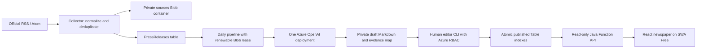

# Architecture

The MVP uses a deterministic daily Java orchestration, a read-only Function API and a static React newspaper. It uses one Storage Account for Function runtime queues/leases/content and private application blobs/tables. No database, search service or autonomous agents.

## Storage keys and query behavior

| Table | PartitionKey | RowKey | Purpose |
|---|---|---|---|
| Sources | registry | sourceId | Config snapshot and lastCheckedAt |
| Sources | ops | budget\|Bratislava-date | CAS daily attempted calls and reserved article IDs |
| Sources | ops | run\|timestamp\|UUID | Execution summaries, no source text/secrets |
| PressReleases | press | url\|SHA256(canonical URL) | Metadata, status, persisted newsworthiness analysis |
| PressReleases | press | hash\|SHA256(normalized body) | Global exact-content deduplication claim |
| Articles | editorial | id\|SHA256(sorted release IDs) | Canonical private metadata and lifecycle |
| Articles | editorial | pub\|reverse epoch milliseconds\|article ID | Published-only chronological keyset pagination |
| Articles | editorial | slug\|slug | Constant-key article lookup |

The duplicate URL and content-hash entries are inserted in one same-partition transaction. An original Blob is immutable and written first; if the transaction loses a duplicate race, the extra private Blob is harmless. Known URL IDs are skipped before downloading bodies. URL tracking parameters and fragments are stripped. Revised content at an existing canonical URL is intentionally not reprocessed in this MVP; a future version can track revisions explicitly.

All article lifecycle, public date-index and public slug-index entities share a partition so publication commits as one Azure Table transaction. ETags prevent stale updates. Published Markdown is written privately first, then the three metadata rows commit together. A failed transaction leaves only private, unreachable bytes. A retry after a successful commit is a no-op. Public API never lists `id|` rows, never signs Blob URLs and never returns storage credentials.

Public list traversal is ascending over reverse timestamps, newest first, with an opaque-in-practice but validated last-row cursor. Page size 1–30 (default 12); no offset scans or whole-table sorting. Category and edition filters are server-side non-key filters within the published row range. At three articles a day this is adequate; larger archives should add monthly/category partitioned indexes. Editorial repair and pending-release queries scan bounded result sets or canonical rows: at MVP volume this is deliberate simplicity, not a scale-out design.

Source originals: `sources/{sourceId}/{yyyy}/{MM}/{urlHash}-{contentHash}.json`. Bodies never live in Table properties. Draft revisions: `articles/drafts/{articleId}/{markdownHash}.md`; generated structured checkpoints are nearby `.json`. Hash-qualified immutable revisions prevent an interrupted edit from overwriting approved bytes. Associated metadata contains title, perex, source URLs, evidence map, model, reviewer and timestamps. Final publication: `articles/published/{yyyy}/{MM}/{articleId}.md`. `images` is reserved and private; no third-party images are downloaded.

## Pipeline and restart safety

1. Acquire a 60-second `sources/_ops/pipeline.lock` lease, renewed every 20 seconds. Editors use the same lease. A lost renewal stops subsequent writes.
2. Collect independently per source with HTTPS allowlists, robots checks, no redirects, one-second body-fetch spacing, 15-second full-response timeouts, a 2 MB ceiling and at most two retries for transient failures. An unavailable robots file other than 404 fails closed.
3. Recover incomplete articles and repair consumed-source flags for completed/rejected articles.
4. Score new material in batches of six. Persist each score, reason, category and topic key. Mark routine/low-score material ignored. The initial seven-day collection window avoids importing years of old news.
5. Group related releases by topic key and reserve up to three article IDs in a persisted daily budget. Insert a private `GENERATING` placeholder before any generation call.
6. Generate JSON, validate schema/lengths, and persist an immutable checkpoint. Recover a checkpoint after a crash; do not regenerate an already stored draft.
7. Run a separate model verification call plus deterministic numeric/quote/evidence/paragraph coverage checks. Store complete drafts whether the verification passes or flags issues. An incomplete/refused response remains private and can be resumed or rejected.
8. Record result and class-only errors. No automatic publication.

The external AI request cannot be atomically committed with Storage. A crash after the service accepts a request but before checkpoint storage may repeat a charged request. Every attempt reserves its daily call count first, so spend remains bounded; duplicate articles remain prevented. Failed requests conservatively consume their reservation. Counts reset at Bratislava midnight; interrupted older articles need a slot in the current day's budget to resume. Article slots are retained after rejection/failure.

## AI contract and grounding

One configured deployment (`gpt-4.1-mini` preferred), three logical stages, strict JSON schema outputs and local validation. The Azure v1 Chat Completions endpoint receives the deployment in `model`. No automatic retry on paid requests; no tools/agent loop. Azure managed identity/CLI identity is preferred; a local API key is optional. Responses with refusal/truncation or invalid source IDs are rejected.

Every prose paragraph, headline and perex has a claim mapping to a release ID and an exact evidence excerpt. Numeric tokens must appear in that excerpt; quoted text must appear in source material. HTML, images and embedded URLs are excluded from generated text; the application attaches authoritative stored URLs. The semantic verifier checks names, dates, quantities, attribution, conflicts and unsupported conclusions. Deterministic checks cannot establish truth or detect every paraphrase error. Source text is treated as untrusted data in prompts; human review remains essential for hallucinations and prompt injection.

Edited text loses approval and AI clearance, needs a fresh verification pass, then named human approval. Approval binds title, perex, category, source URLs, claim map, model and Markdown hash. Potentially damaging allegations are flagged and need an extra CLI acknowledgement. Detection is conservative and incomplete; the human reviewer must assess risk even when the flag is absent.

## Costs and observability

Defaults: 3 article reservations/day, 20 considered releases/run, 12 attempted AI calls/day, 2,200 generation output tokens, 45-second AI timeout, relevance threshold 65. Ranking batches and checks have smaller caps. Sources are truncated to 10,000 characters per AI context; the full original remains stored for humans. Generation length is 120–220 words to fit both article and evidence map within the configured output budget. If truncation hides necessary evidence, the output must be rejected or corrected rather than inferred.

Optional `AI_INPUT_USD_PER_MILLION` / `AI_OUTPUT_USD_PER_MILLION` settings log estimates and usage; zero means pricing is unconfigured, not free. Azure pricing differs by deployment type/region and is not hardcoded. Operations use JUL/context logging collected by the Function host; supply Application Insights connection string for production. Keep sampling and ingestion caps in existing monitoring. Storage and runtime/telemetry costs still exist outside free allowances; daily AI limits are not a global Azure spending cap.

The Consumption timeout is ten minutes. The pipeline starts with an eight-minute deadline, collection receives at most two minutes of it, and another AI stage is not begun without timeout margin. Storage SDK operations retain bounded retry policies, but an outage can still cause host termination; checkpoints make the next run recoverable. Timer monitors live in runtime Storage artifacts separate from application names.

## HTTP and frontend

All deployed HTTP bindings accept GET only. The three endpoints validate slugs, cursors, categories and page sizes. Bad inputs return 400, unknown/unpublished slug 404, unavailable dependencies 503. Successful public metadata is cacheable for 30 seconds. Azure CORS permits the exact SWA origin; local Core Tools permits localhost:5173. CORS is not authorization: content is public while administration exists only in CLI.

React uses typed clients, request cancellation/timeouts and real live API loading. Markdown passes through DOMPurify with a small allowlist; URLs on the source list accept HTTPS only. Locally hosted Newsreader fonts use the SIL Open Font License. No third-party analytics/font CDN is needed. SPA route fallback preserves shareable article URLs.

CSR has limited initial HTML/social preview and search discoverability. Later add prerendered approved-article HTML generated by a storage/publication event, or server rendering; keep the dynamic API and do not couple new publication to a manual Git change or frontend release.
