# Architecture

The MVP uses a deterministic daily Java orchestration, a read-only Function API and a static React newspaper. It uses one Storage Account for Function runtime queues/leases/content and private application blobs/tables. No database, search service or autonomous agents.

```mermaid
flowchart LR
  S[Official RSS / Atom] --> C[Collector: normalize and deduplicate]
  C --> B[Private sources Blob container]
  C --> T[PressReleases table]
  T --> P[Daily pipeline with renewable Blob lease]
  P --> A[Writer: initial private concept]
  A --> Q[Stronger assistant: question and approved site IDs]
  Q --> H[Bounded official search / HTML / text PDF / archive]
  H --> N[Stronger assistant: cited findings and limitations]
  N --> W[Writer: one researched revision]
  W --> D[Fresh verification and exact evidence map]
  D --> E[Separate stronger AI chief editor]
  E --> I[Atomic published Table indexes]
  I --> R[Read-only Java Function API]
  R --> F[React newspaper on SWA Free]
```

## Storage keys and query behavior

| Table | PartitionKey | RowKey | Purpose |
|---|---|---|---|
| Sources | registry | sourceId | Config snapshot and lastCheckedAt |
| Sources | ops | budget\|Bratislava-date | CAS daily attempted calls and reserved article IDs |
| Sources | ops | run\|timestamp\|UUID | Execution summaries, no source text/secrets |
| PressReleases | press | url\|SHA256(canonical URL) | Metadata, status, persisted newsworthiness analysis |
| PressReleases | press | hash\|SHA256(normalized body) | Global exact-content deduplication claim |
| Articles | editorial | id\|SHA256(sorted release IDs) | Canonical private metadata and lifecycle |
| Articles | editorial | pub\|reverse epoch milliseconds\|article ID | Published-only chronological keyset pagination |
| Articles | editorial | slug\|slug | Constant-key article lookup |

The duplicate URL and content-hash entries are inserted in one same-partition transaction. An original Blob is immutable and written first; if the transaction loses a duplicate race, the extra private Blob is harmless. Known URL IDs are skipped before downloading bodies. URL tracking parameters and fragments are stripped. Revised content at an existing canonical URL is intentionally not reprocessed in this MVP; a future version can track revisions explicitly.

All article lifecycle, public date-index and public slug-index entities share a partition so publication commits as one Azure Table transaction. ETags prevent stale updates. Published Markdown is written privately first, then the three metadata rows commit together. A failed transaction leaves only private, unreachable bytes. A retry after a successful commit is a no-op. Public API never lists `id|` rows, never signs Blob URLs and never returns storage credentials.

Public list traversal is ascending over reverse timestamps, newest first, with an opaque-in-practice but validated last-row cursor. Page size 1–30 (default 12); no offset scans or whole-table sorting. Category and edition filters are server-side non-key filters within the published row range. At three articles a day this is adequate; larger archives should add monthly/category partitioned indexes. Editorial repair and pending-release queries scan bounded result sets or canonical rows: at MVP volume this is deliberate simplicity, not a scale-out design. The edition API retains capacity for historical five-item editions; new publication has the three-article ceiling.

Source originals: `sources/{sourceId}/{yyyy}/{MM}/{urlHash}-{contentHash}.json`. Bodies never live in Table properties. Draft revisions: `articles/drafts/{articleId}/{markdownHash}.md`; generated structured checkpoints are nearby `.json`. Hash-qualified immutable revisions prevent an interrupted edit from overwriting approved bytes. Associated metadata contains title, perex, source URLs, evidence map, model, reviewer and timestamps. Final publication: `articles/published/{yyyy}/{MM}/{articleId}.md`. `images` is reserved and private; no third-party images are downloaded.

## Pipeline and restart safety

1. Acquire a 60-second `sources/_ops/pipeline.lock` lease, renewed every 20 seconds. Editors use the same lease. A lost renewal stops subsequent writes.
2. Collect independently per source with HTTPS allowlists, robots checks, no redirects, one-second body-fetch spacing, 15-second full-response timeouts, a 2 MB ceiling and at most two retries for transient failures. An unavailable robots file other than 404 fails closed.
3. Restore incorrectly consumed legacy context, prepare at most one separately audited citation correction for an eligible preliminary rejection, recover incomplete articles and repair consumed flags for primary topic inputs only. Context never suppresses another news topic.
4. Score new material in batches of six. Persist each score, reason, category and topic key. Mark routine/low-score material ignored. Collection keeps available documents up to 90 days old; those older than seven days are marked context and never ranked as fresh news.
5. Group new releases by topic key and reserve up to six concept IDs. Insert a private `DRAFTING` placeholder before model calls. The writer creates an initial concept; a stronger assistant plans targeted official-source research. Java discovery uses the fixed research registry, records original texts and retrieval gaps, then the assistant evaluates the obtained documents. Legacy `GENERATING` work retains the original pre-writing archive analyst path.
6. Rewrite once from the accepted research. Validate schema/lengths, institutional independence, coverage of relevant institutional findings, and exact citations. Persist immutable initial/plan/retrieval/brief/rewrite checkpoints, move to `VERIFYING`, and reuse completed stages after a crash. New context records never become independently ranked fresh-news candidates.
7. Run a separate model verification call plus deterministic numeric/quote/evidence/paragraph coverage checks. Store complete drafts whether the verification passes or flags issues. An incomplete/refused response remains private and can be resumed or rejected.
8. Review already completed drafts before new AI work and each newly completed researched draft immediately, then make a final recovery pass. Publish at most three articles per Bratislava day. The cap includes manual publication, runs under the shared lease and counts actual publication timestamps. This ordering avoids spending all calls on new concepts before final review. Record aggregate results and class-only errors; editor exception details are logged privately.

The assistant uses `research-sites.json`: 30 exact-host entries with institutional groups, discovery modes, content selectors and scope. Eight sites require unsupported dedicated connectors and are reported as gaps. Search RSS 2.0 is available for IFP/RRZ/NBS; other supported entries use feeds or bounded link discovery. Retrieval has 65 seconds and 16 HTTP requests including robots, with eight-second timeouts, no retries, 2 MB bodies and one-second spacing. It tries at most two phrases, two results per site and one PDF attachment per page; six documents total include primary inputs. PDFBox reads text PDFs up to 60 pages/50,000 characters, preserving page labels; image-only/encrypted/oversized documents fail. Retrieval is not exhaustive and never follows model-generated URLs or redirects.

`articles/assistant/{articleId}/{inputHash}/` binds the primary sources, writer/assistant model identities, policy and complete registry. It stores the private first concept, plan, full retrieval snapshot/gaps, accepted brief and rewritten draft. Invalid briefs have separate private audit files. Unknown publication dates use an internal epoch sentinel exposed to models as `unknown`; fetch time is never presented as publication time. Related archive retrieval remains bounded to 100 records and at most six total inputs.

The external AI request cannot be atomically committed with Storage. A crash after the service accepts a request but before checkpoint storage may repeat a charged request. Every attempt reserves its daily call count first, so spend remains bounded; duplicate articles remain prevented. Failed requests conservatively consume their reservation. Counts reset at Bratislava midnight; interrupted older articles need a slot in the current day's budget to resume. Article slots are retained after rejection/failure.

## AI contract and grounding

One writing deployment (`gpt-4.1-mini` preferred) handles ranking, generation and verification. Automatic mode adds a separate stronger chief-editor deployment (`gpt-4.1` preferred), in the same account, for one final publication decision. Both use strict JSON schema outputs and local validation. The writer returns the title, perex and paragraphs once, each with a source ID and a provided evidence-excerpt ID. Deterministic code attaches the exact original excerpt and assembles publication text from those objects; neither the prose nor the evidence is recopied by the model. Excerpts are contiguous, bounded and overlap at boundaries. Unknown identifiers are rejected; selecting a valid excerpt does not bypass numeric, quotation or semantic checks. Stored checkpoints and optional manual exports still use the Draft format. The Azure v1 Chat Completions endpoint receives the deployment in `model`. No immediate automatic retry on paid requests; no tools/agent loop. Azure managed identity/CLI identity is preferred; a local API key is optional. Responses with refusal/truncation or invalid source IDs remain unpublished.

Every prose paragraph, headline and perex has a claim mapping to a release ID and an exact evidence excerpt. The new `researched-draft` schema allows one to three citations per field. Existing Claim records are reused: identical paragraph text with different references means multiple citations. Numeric tokens and quotes must occur in valid excerpts attached to that exact paragraph; another paragraph cannot lend evidence. Semantic review checks the actual attribution and relationship, since number presence alone is insufficient. HTML, images and embedded URLs are excluded; the application attaches authoritative stored URLs. The final editor rechecks sources, neutrality, context and readability independently. Institutional groups prevent MF/IFP/UHP and ŠÚ/STATdata from masquerading as independent confirmation. Deterministic checks and AI reviewers cannot establish truth or detect every paraphrase error. Source text is untrusted data, never tool instructions.

Edited text loses approval and AI clearance, needs a fresh verification pass, then renewed editorial approval. Approval binds title, perex, category, source URLs, claim map, model and Markdown hash. Automatic decisions are stored in private immutable review blobs keyed by the article, full original source records, editor deployment and policy version. A crash after audit persistence or approval resumes without another review call. Publication reuses the global lease and the same atomic public-index transaction. Damaging allegations and failed checks are rejected automatically. Optional manual recovery retains explicit human approval and sensitive acknowledgement. Detection is conservative and incomplete; automated checks do not guarantee absence of sensitive or incorrect claims.

## Costs and observability

Defaults: 6 concept reservations/day, at most 3 publications/day, 40 considered releases/run, 40 attempted AI calls/day, 2,200 generation output tokens, 45-second AI timeout, relevance threshold 65. Older 8/5 environment settings are clamped to 6/3 for rollout compatibility. Ranking batches and checks have smaller output caps. Assistant planning uses at most 1,000 output tokens, evaluation at most 1,800 and final review at most 1,600. A successful six-concept/three-publication baseline plus seven ranking batches uses the 40-call allowance; retries/corrections can reduce output. New research reads full stored bodies with a 200,000-character total ceiling, and receives at most twelve selected stable excerpts per source; accepted finding excerpts are retained for the rewrite. Verification and final review use full originals under the same ceiling. Initial/legacy writing retains 10,000-character excerpts. Researched articles target 180–260 body words, shorter when evidence is limited. Missing evidence is never inferred.

Optional `AI_INPUT_USD_PER_MILLION` / `AI_OUTPUT_USD_PER_MILLION` settings log estimates and usage; zero means pricing is unconfigured, not free. Azure pricing differs by deployment type/region and is not hardcoded. Operations use JUL/context logging collected by the Function host; supply Application Insights connection string for production. Keep sampling and ingestion caps in existing monitoring. Storage and runtime/telemetry costs still exist outside free allowances; daily AI limits are not a global Azure spending cap.

The Consumption timeout is ten minutes. The pipeline starts with an eight-minute deadline, collection receives at most two minutes of it, and another AI stage is not begun without timeout margin. Storage SDK operations retain bounded retry policies, but an outage can still cause host termination; checkpoints make the next run recoverable. Timer monitors live in runtime Storage artifacts separate from application names.

## HTTP and frontend

All deployed HTTP bindings accept GET only. The three endpoints validate slugs, cursors, categories and page sizes. Bad inputs return 400, unknown/unpublished slug 404, unavailable dependencies 503. Successful public metadata is cacheable for 30 seconds. Azure CORS permits the exact SWA origin; local Core Tools permits localhost:5173. CORS is not authorization: content is public while administration exists only in CLI.

React uses typed clients, request cancellation/timeouts and real live API loading. Markdown passes through DOMPurify with a small allowlist; URLs on the source list accept HTTPS only. Locally hosted Newsreader fonts use the SIL Open Font License. No third-party analytics/font CDN is needed. SPA route fallback preserves shareable article URLs.

CSR has limited initial HTML/social preview and search discoverability. Later add prerendered approved-article HTML generated by a storage/publication event, or server rendering; keep the dynamic API and do not couple new publication to a manual Git change or frontend release.
