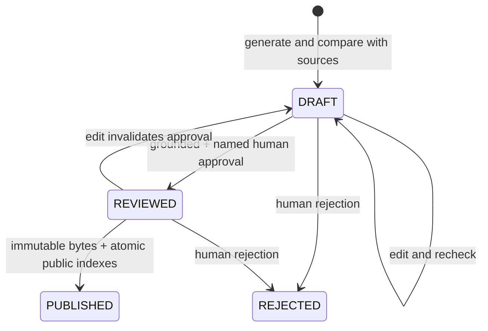

# Editorial workflow

## Planned editions and private reserve

With `NEWSROOM_FLOW_ENABLED=true` (default for Azure; requires the research flow), the desk discovers topics before a concept exists. It combines the six regular feeds with a rotating scan of supported sites in the 30-site approved catalog. Each scan visits up to five supported sites, tries up to three unknown links per site, adds up to six documents and uses at most 90 seconds / 24 HTTP requests including robots. The cursor persists under `Sources.ops/discovery-cursor`; unavailable sites do not reset the rotation. Unsupported registry/data connectors remain explicit gaps. HTML discovery is bounded link matching, not unrestricted web search or guaranteed coverage of every page. Originals are archived as reusable `CONTEXT`.

The stronger planning editor receives up to 24 unused documents from the 90-day archive plus article/rejection history. It commissions up to six questions with real source IDs, a public-interest score and a format: `NEWS`, `ANALYSIS` or `EXPLAINER`. The desk favors a mix without forcing weak topics. Unknown dates cannot qualify as fresh news. A stable primary-document/policy ID prevents title changes or a new manual UUID from regenerating the same commission. Previously used documents may provide research context, while new primary documents can support a materially new angle. Planning notes and questions are not evidence.

`PrepareEdition` runs at **09:00, 15:00 and 21:00 UTC** and builds a private reserve of up to `READY_ARTICLE_TARGET=9` approved articles. It never publishes. `MorningEdition` uses the existing `DAILY_SCHEDULE` (03:00 UTC by default); `AdHocEdition` uses the same edition selection immediately with its own budget. Both first try approved reserve articles, then commission additional work if needed. Preparation and the morning timer share the same Bratislava-day 6-concept / 40-call ledger; the scheduled publication ceiling stays three. New concepts, revisions, planning, verification and final-editor attempts are all bounded. Three successful freshly written articles normally require 25 AI calls including planning; failed calls/revisions can reduce the result. The reserve is built over successive runs, not promised on first deployment.

An approved news commission expires after two days; an analysis/explainer after seven. Publication refetches every original through approved hosts/robots and supported extractors, then reruns the verifier and independent stronger editor against current full source bodies. Current snapshots, verification and final approval are private, content-bound checkpoints under `articles/publication-checks/`; they may be reused only within the same 15-minute slot after an interrupted publication. Unavailable originals, unsupported extraction, changed evidence, sensitive findings, expired commissions or exhausted budgets defer publication. Archived originals remain immutable. This refresh covers the cited URLs, not all later events or the whole web.

`Sources.ops/story|ID` stores the immutable commission and expiry. `feedback|ID` records `REVISE`, `HOLD` or `DROP`; `reserve-hold|ID` records a publication deferral. At most two rejected topics per run are triaged. `REVISE` allows one separately identified successor with concrete instructions, fresh verification and fresh editor approval, preserving original institutional perspectives. The original rejection is never overwritten and a successor cannot start another revision chain. Sensitive drafts and known legacy correction successors are excluded. `HOLD` and `DROP` do not spend repeated rewrite calls; a genuinely new document may later support a new commission.

Inspect `newsroom-run|...` records for `mode`, `ready`, `held`, `publicationShortfall`, `calls`, `concepts`, `blockers` and `discoveryGaps`, alongside the normal scope-tagged `run|...` summary. Repeating an already full edition reports no shortfall; no new concept attempt is charged simply to publish a ready article. A shortfall never permits skipping checks. `editorial.ps1 newsroom` is read-only; `editorial.ps1 prepare` performs scheduled-budget preparation without publishing. Set `NEWSROOM_FLOW_ENABLED=false` to use the legacy feed-driven workflow while retaining private newsroom state.

## Automatic AI editor (production)

Daily operation no longer requires a human editor when `AUTO_PUBLISH_ENABLED=true`. Topic ranking, writing and source verification use `AZURE_OPENAI_DEPLOYMENT` (normally `gpt-4.1-mini`). A separate final chief-editor call uses `AZURE_OPENAI_EDITOR_DEPLOYMENT` (normally `gpt-4.1`, in the same OpenAI account). There is no fallback to the writing model. Model names are configurable; operators must select an actually stronger model for the editor deployment, not another alias for the same model.

The final editor rechecks the exact title, perex, article and evidence against full original source texts, then approves or rejects based on grounding, attribution, neutrality, context and readability. New concepts follow the post-concept assistant flow below before reaching this editor. Full-source research, verification and final-review contexts have a 200,000-character total ceiling; oversized inputs fail rather than silently truncate approval evidence. Publication requires passing deterministic checks, passing the first AI fact check, an unambiguous final approval with no unresolved issues, and no sensitive flag. Damaging allegations are excluded from automatic publication. Completed drafts that fail grounding or editorial review become `REJECTED`; no human action is needed to skip them. Timeouts, refusals, malformed responses and exhausted budgets leave drafts private for a later scheduled attempt. The final reviewer does not rewrite: the newsroom can separately commission the one audited successor described above, while the legacy flow keeps its narrower numeric-citation correction.

Approval passes through `DRAFT → REVIEWED → PUBLISHED`, with the same immutable content hash and atomic Table indexes as manual publication. A private `articles/reviews/{articleId}/{inputHash}.json` records the editor deployment, policy version, timestamp and decision. Its key binds the exact article, full original source records, model and policy. Restarting after a saved decision or interrupted publication reuses that decision without another paid call. Editing content or changing source inputs invalidates it. Public disclosure distinguishes AI approval from human approval; automatic articles explicitly say they were not reviewed by a human. Multiple AI checks still do not establish independent truth.

Daily defaults allow **6 concept attempts** (`MAX_ARTICLES_PER_DAY=6`) and **at most 3 publications** (`MAX_PUBLISHED_ARTICLES_PER_DAY=3`). Rejected/interrupted concepts keep their attempt reservation but do not consume publication slots. The publication cap is checked under the global lease using actual Bratislava publication dates, includes manual publication, survives restart and does not spend final-editor calls after the cap is full. Waiting drafts remain private until a later day; their edition date is assigned at publication. These are upper limits, not guaranteed output targets. Older deployed 8/5 settings are accepted during rollout but clamped to the new 6/3 ceilings; ledger history is retained.

All stages and retries share `MAX_AI_CALLS_PER_DAY=40`. Six new concepts need up to 30 initial-writing/planning/research/rewriting/verification calls; seven ranking batches and three final reviews bring that successful baseline to 40. Failures or corrections consume the same allowance, so fewer completed concepts may result. Existing completed drafts are reviewed before fresh work, and each newly completed draft is reviewed immediately, preserving a chance to publish before another topic consumes the remaining calls. Usage pricing for the assistant and editor uses `EDITOR_INPUT_USD_PER_MILLION` / `EDITOR_OUTPUT_USD_PER_MILLION`; zero means unconfigured, not free.

The author writes each title/perex/paragraph once and selects an evidence-excerpt ID from the supplied originals. Application code attaches the exact original excerpt and constructs the article from the same text fields. This avoids drift between two copies of the prose and avoids transcription mistakes in quotations. Valid excerpt selection is not proof of support: numeric, quote, semantic verification and final editor checks still apply. Preliminary failures are attributed to `Automatic checks`; only an actual final-editor decision is attributed to `AI editor: MODEL`.

Local defaults and infrastructure leave automatic publication disabled until the stronger deployment is provisioned and the updated code is deployed. Follow [activation instructions](deployment.md#activate-the-automatic-ai-editor) once. After activation, the morning timer publishes accepted articles directly; frontend rebuilds are unnecessary for later articles. Set `AUTO_PUBLISH_ENABLED=false` to suspend automatic publication while retaining collection and draft generation.

## Document analyst

### New post-concept assistant flow

`RESEARCH_FLOW_ENABLED` defaults to true for Azure AI and false for mock AI. A new topic starts in internal `DRAFTING` phase. The writer first produces an unverified private concept from primary documents. A separate stronger assistant selects one question, one or two short search phrases and up to four IDs from [the official research registry](../backend/src/main/resources/research-sites.json). The Java orchestrator rejects unknown IDs and supplies a fixed RRZ attempt for budget concepts if the planner omits it. The model never generates fetch URLs or gets arbitrary browsing tools.

The lookup reads official search RSS 2.0 for IFP/RRZ/NBS, existing feeds, or relevant links from configured HTML entry points. It tries both planned phrases, at most two results per selected site, and one PDF attachment per page. Related archived originals fill remaining capacity. Bounds: six documents including primary inputs, 65 seconds, 16 actual HTTP requests including robots, 2 MB per response, eight-second timeout, no HTTP retry, and one-second spacing. Exact HTTPS hosts, DNS checks and robots rules apply; redirects are not followed. Unsupported connectors, unavailable pages, unknown dates and bounds become explicit private retrieval gaps. No search result means only that this bounded search found no usable result, not that no document exists.

Text PDFs use Apache PDFBox with page markers, a 60-page ceiling and 50,000-character extracted-body ceiling. Encrypted/oversized PDFs, image-only scans and unsupported spreadsheet formats fail as evidence; no OCR is claimed. PDF publication dates are left unknown unless independently established, not inferred from fetch time or the referring page. Other extracted HTML uses configured content selectors; navigation is removed and missing selectors fail closed. Feed originals may remain available when linked full pages cannot be retrieved. The lookup stores new originals as `CONTEXT`, not fresh breaking-news candidates, and respects immutable URL/content deduplication.

The assistant then reads the collected original bodies and evaluates them against the initial concept. It emits exact-excerpt findings, limitations and private unanswered leads. Stable excerpts cover the full stored source; at most twelve relevant/introductory excerpts per source are supplied, with accepted finding excerpts additionally preserved for rewriting. A body passage without an offered evidence ID cannot acquire a fabricated citation. Numerical findings still require exact numeric support; invalid findings are privately recorded and unsupported numeric observations are removed before the accepted brief is saved.

The writer receives the accepted findings and limitations and rewrites the concept once. Private leads are omitted. Title, perex and paragraphs may cite one to three original excerpt references. Existing stored Claim records remain compatible: identical paragraph text with different source IDs represents multiple citations. Numeric and quote checks use only the valid excerpts attached to that exact paragraph; another paragraph cannot lend evidence. Independent semantic verification still checks which source actually supports each attributed assertion. A viable comparison needs distinct institutional groups, and the rewritten draft must retain every institutional perspective represented by supported findings. MF/IFP/UHP and ŠÚ/STATdata each count as one group.

The final result receives fresh verification and a separate chief-editor decision. The assistant's sensitive flag survives every subsequent checkpoint, so a benign rewrite or verifier cannot erase it. The initial concept cannot publish on its own. This implements one research pass and one rewrite, not a loop that keeps trying to force approval. Published articles are not rewritten; a rejected original can only have the single audited successor described above. Older `GENERATING` work resumes its original analyst workflow below.

Private `articles/assistant/{articleId}/{inputHash}/` stores `initial.json`, `plan.json`, `retrieval.json`, `brief.json` and `rewritten.json`. The root hash binds primary originals, both model identities, assistant policy and the entire allowlist. Retrieval snapshots retain full selected originals and gaps; accepted brief audits bind model/policy/input identity. Saved stages are reused after interruption without another paid call or web search. Invalid proposals are stored separately and never reused as accepted briefs. A crash after AI acceptance but before persistence remains an unavoidable possible duplicate charged attempt; the daily reservation is never refunded.

The catalog includes 30 sites; eight require unsupported data/application/register connectors and are explicitly recorded as gaps when selected. HTML discovery is bounded and may fail if selectors change. This release does not claim automated CRZ/RPVS/RÚZ/ORSR or STATdata checking, exhaustive source coverage, source interviews or an original investigation. See [approved-research-websites.md](approved-research-websites.md).

### Legacy pre-writing archive analyst

Ranking selects newsworthy topics; the separate analyst performs a bounded document comparison using `gpt-4.1` in a fresh conversation. Collection archives up to 90 days of available feed material with a per-institution share of the 40-document run budget. Material older than seven days is context, not a new-news candidate. For each selected topic, deterministic retrieval searches at most 100 archived records for lexical overlap and adds relevant material from another institution, with six documents total. Retrieval is a lead generator, not proof of a connection. The archive starts with what the collectors have actually retrieved; it is not an exhaustive 90-day history.

The analyst produces a question, evidence-referenced findings, limitations and private unanswered leads. It can declare the comparison unviable. Findings select the same original excerpt identifiers used by the author. Unknown identifiers fail locally. A finding whose numbers are not present in its exact selected excerpt is discarded, with the original proposal retained privately; no replacement citation or number is invented. Only retained supported findings enter the writer's brief. An analytical brief needs findings from at least two institutions, and its draft must retain claims from at least two institutions. Losing that coverage downgrades the brief to ordinary news. The draft is then checked by the ordinary verifier and independent final editor. A sensitive analyst flag is retained even if later checks overlook it or all its numeric findings are discarded. The writer receives findings and limitations, but never the private leads.

Private `articles/research/{articleId}/{inputHash}.json` audits bind the full input sources, analyst deployment and policy version. A writing interruption reuses a stored brief without another analyst call. Parsed responses that fail local validation are recorded separately in `research-errors/`; the unvalidated proposal cannot be reused as an accepted brief or exposed by the public API. A filtered subset must pass validation before receiving an accepted audit. Operational errors include only known fixed validation messages. The analyst sees bounded original excerpts, not every sentence of an oversized original; final editorial approval still uses full originals. Neither the analyst nor the writer can browse arbitrary websites, invent citations, read unprovided PDF attachments, contact subjects or claim an original investigation.

The editorial principle associated with Ján Kuciak's legacy is evidence that a reader can check: follow public money and decisions, preserve attribution and uncertainty, and separate a documented fact from a hypothesis. AI does not substitute for access to documents, source interviews or a right-of-reply process. Current automated publication continues to exclude damaging allegations. CRZ contract exports, procurement notices and beneficial-owner registers are useful next integrations, but are not collected by this release; no article may imply they were checked.

## One citation correction

When generation selects an excerpt that omits a number in its paragraph, the assembler may choose another supplied contiguous excerpt **from the same document** that contains all that paragraph's numeric values. It prefers lexical overlap and uses deterministic tie-breaking. It never transfers a claim to another document, stitches distant spans or treats number presence as semantic approval. If no such excerpt exists, the original citation remains and strict grounding rejects it. This also applies to title and perex mappings; unknown evidence identifiers still fail.

An automatic preliminary rejection with a numerical evidence-mapping error can create **one new correction concept** while its primary documents are still within the seven-day news window. The rejected parent remains immutable. Final AI-editor rejections, human rejections, sensitive stories and failed correction concepts do not enter this path. The deterministic successor ID prevents a correction chain or a new attempt on every run. This additional concept consumes one of the six daily concept slots; its attempted model calls consume the shared 40-call budget and any eventual publication consumes the same three-publication allowance.

The correction uses `gpt-4.1` in a fresh writing call with the rejected draft, errors and original excerpt identifiers. It must remove unsupported claims or select sufficient exact evidence; no check is waived. The corrected draft receives a fresh first verification and a fresh final editor decision in another conversation. These correction and final-review calls use the same stronger deployment but separate conversations; the primary generation deployment remains `gpt-4.1-mini`. Existing analytical two-institution coverage is retained. Private `corrections/{successorId}/input.json` binds the immutable parent, full source inputs, correction policy and model; a stored generated checkpoint avoids repeating the correction after a crash. The source metadata marks only primary topic inputs consumed. Context remains reusable and cannot suppress a separate news topic. The pipeline also restores incorrectly consumed legacy context conservatively using the original topic ID.

## Ad hoc run outside daily limits

The scheduled timer retains the Bratislava-day ledger and daily 6/3/40 limits. Explicit ad hoc execution has its own `budget|adhoc|UUID` ledger in `Sources.ops`, with the same configured limits applied per manual run. It can work after scheduled calls, concepts or publications are exhausted. Its calls/concepts do not mutate the daily ledger; its publications are tagged `publicationScope=adhoc|UUID` on canonical/public/slug rows in the same atomic Table transaction, and do not reduce scheduled publication capacity. Older untagged publications remain classified as scheduled. Ordinary standalone human CLI `publish` remains part of the daily allowance.

Use the separate `AdHocEdition` function. Its queue binding (`editorial-adhoc`, using the existing host `AzureWebJobsStorage` connection) preserves manual input; the native admin call invokes it directly without enqueueing a message. `MorningEdition` always uses the daily budget: Azure timer binding replaces admin input with TimerInfo, so that endpoint cannot select an ad hoc scope. The Azure native admin endpoint requires `_master` in `x-functions-key`. Use an explicit run ID so retrying a request continues the same bounded run instead of creating another budget:

```powershell
$runId = [guid]::NewGuid().ToString()
$key = $null
try {
    $key = az functionapp keys list --resource-group verejny-dohlad --name verejnydohlad-wny6o5yct2uf2 --query masterKey --output tsv
    if ($LASTEXITCODE -ne 0 -or [string]::IsNullOrWhiteSpace($key)) { throw 'Master key unavailable.' }
    $body = @{ input = "adhoc:$runId" } | ConvertTo-Json -Compress
    $response = Invoke-WebRequest -UseBasicParsing -Method Post `
        -Uri 'https://verejnydohlad-wny6o5yct2uf2.azurewebsites.net/admin/functions/AdHocEdition' `
        -Headers @{ 'x-functions-key' = $key } -ContentType 'application/json' `
        -Body $body -TimeoutSec 60
    "HTTP $($response.StatusCode); runId=$runId"
}
finally { $key = $null }
```

HTTP 202 acknowledges the request; the pipeline completes asynchronously. In Function App → Monitoring → Log stream, look for `AdHocEdition`, the `pipeline-started` event with its scope, and the final `{scope,result}` summary. For a completed run, open Storage browser → Tables → Sources and filter `PartitionKey eq 'ops'`; find a `run|...` row with `scope=adhoc|UUID`. Its JSON `payload` contains `completedAt`, `collected`, `drafts`, `published`, `rejected` and `errors`. The run row is written at completion, not at request acceptance; a host crash may leave no final row. Function execution success alone does not guarantee a publication or empty `errors`. Application Insights invocation history is another option when configured.

`{"input":"adhoc"}` generates a fresh ID, and the earlier `manual-after-update` marker is also recognized as ad hoc on `AdHocEdition`. Invalid IDs, empty input and unsupported input fail instead of falling back to the scheduled budget. The admin endpoint is Azure's platform endpoint, not a new anonymous application HTTP route.

CLI `editorial.ps1 run` is now ad hoc; `editorial.ps1 run UUID` resumes that manual budget. A global lease still prevents overlapping scheduled/manual runs. Content IDs, immutable evidence, approvals and publication transactions are unchanged, so re-running cannot duplicate terminal stories or force unsupported publication. A manual run can complete existing private work; older charged/reserved daily attempts remain counted. If a later scheduled run continues unfinished work, those new attempts count in that scheduled day's ledger. All paid manual calls remain chargeable. There is no aggregate daily ceiling across arbitrary new manual IDs; only authorized administrators can invoke this path.

## Optional manual recovery

Individual editorial recovery operations use the local Java CLI with Azure RBAC, or Azurite for development. Whole-run invocation also has the authenticated Azure platform endpoint described above. `scripts/editorial/editorial.ps1` compiles Java and builds a classpath on first use, loads ignored local settings, and invokes `Cli` directly without a shell-built command. Use `-SkipBuild` only after an unchanged successful build. Explicit environment values override local settings.

## Commands

```powershell
./scripts/editorial/editorial.ps1 init
./scripts/editorial/editorial.ps1 -SkipBuild collect
./scripts/editorial/editorial.ps1 -SkipBuild run
./scripts/editorial/editorial.ps1 -SkipBuild list
./scripts/editorial/editorial.ps1 -SkipBuild inspect ARTICLE_ID
New-Item -ItemType Directory -Force editorial-export | Out-Null
./scripts/editorial/editorial.ps1 -SkipBuild export ARTICLE_ID editorial-export/draft.json
# Edit the local JSON: title, perex, category, markdown, claims.
./scripts/editorial/editorial.ps1 -SkipBuild edit ARTICLE_ID editorial-export/draft.json
./scripts/editorial/editorial.ps1 -SkipBuild recheck ARTICLE_ID
./scripts/editorial/editorial.ps1 -SkipBuild approve ARTICLE_ID 'Human editor name'
./scripts/editorial/editorial.ps1 -SkipBuild publish ARTICLE_ID
# For damaging allegations, after assessing original evidence and attribution:
./scripts/editorial/editorial.ps1 -SkipBuild approve ARTICLE_ID 'Human editor name' --ack-sensitive
# Reject a completed or interrupted draft:
./scripts/editorial/editorial.ps1 -SkipBuild reject ARTICLE_ID 'Human editor name'
```

`run` with Azure AI can incur charges; `collect` and `check-feeds` do not call AI. An edit's `claims` must contain exact paragraph text, supplied release ID and exact source evidence; the title/perex also need entries. `inspect` prints full originals, evidence mappings, flags and article text. Do not paste private originals into public issue trackers. The local export directory is ignored.

## Decisions before approval

Read the draft and original sources, opening original URLs. Check names, dates, numbers, quotes, omissions and conclusions. Determine whether the source actually supports each statement and whether the article clearly attributes issuer claims. A press release is not independent proof of those claims. Review uncertainty and scope; MH SR currently supplies summaries, not full retrieved documents. Follow links to read complete originals where needed; updating article evidence with independent sources requires an explicitly implemented additional collector, not invented model references.

The model newsworthiness score ranks public interest, not truth. A passing AI check is not a human review. Sensitive flags are conservative and incomplete. Always assess allegations of corruption, crime, misconduct or reputational harm, even when the detector is false. The additional acknowledgement records a deliberate review step; it does not make an unsupported allegation publishable.

## States



Generated text starts as `DRAFT`. In automatic mode, completed failed checks are rejected and eligible drafts proceed to the final AI editor. In manual mode, failed checks remain drafts with explicit issues. The new assistant flow stays `DRAFTING` until its immutable researched rewrite is stored, then moves to `VERIFYING`. Legacy work uses `GENERATING`/`VERIFYING`; a citation correction begins in `CORRECTING`. Interrupted work can resume or be rejected and is never public before approval. Rejected primary input material is consumed so ordinary generation does not recreate the same story. Rejected/published articles remain terminal; the bounded correction creates a separately audited successor rather than reopening its parent.

Approving requires a complete draft with passing semantic and deterministic checks. Edits reset approval/reviewer/hash, so the article must be rechecked and approved again. The approval hash includes title, perex, category, source URLs, evidence, model and Markdown. Publishing verifies that hash and reviewed metadata before writing an immutable private published Blob and committing canonical/public/slug rows together.

If publishing fails, readers cannot see a partially published article. Retry `publish` with the same ID; after a successful Table commit a repeated command returns successfully without another article. If a human changes underlying Storage outside the CLI, the hash checks or ETags reject ordinary mismatches; authorized Storage contributors are still trusted and can bypass application rules, which is why editor membership must remain narrow.

All articles show AI disclosure and source references under **Ako sme na to prišli**. No automatic independent verification is claimed. No synthetic fixture can be created/published through CLI to cloud Storage.
