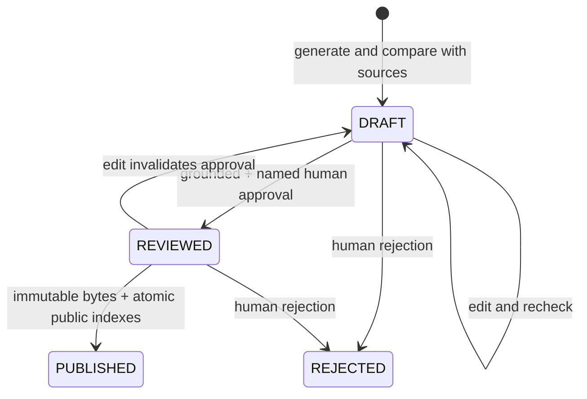

# Human editorial workflow

No administrative HTTP endpoint is deployed. Use the local Java CLI as a trusted editor with Azure RBAC, or with Azurite for development. `scripts/editorial/editorial.ps1` compiles Java and builds a classpath on first use, loads ignored local settings, and invokes `Cli` directly without a shell-built command. Use `-SkipBuild` only after an unchanged successful build. Explicit environment values override local settings.

## Commands

```powershell
./scripts/editorial/editorial.ps1 init
./scripts/editorial/editorial.ps1 -SkipBuild collect
./scripts/editorial/editorial.ps1 -SkipBuild run
./scripts/editorial/editorial.ps1 -SkipBuild list
./scripts/editorial/editorial.ps1 -SkipBuild inspect ARTICLE_ID
New-Item -ItemType Directory -Force editorial-export | Out-Null
./scripts/editorial/editorial.ps1 -SkipBuild export ARTICLE_ID editorial-export/draft.json
# Edit the local JSON: title, perex, category, markdown, claims.
./scripts/editorial/editorial.ps1 -SkipBuild edit ARTICLE_ID editorial-export/draft.json
./scripts/editorial/editorial.ps1 -SkipBuild recheck ARTICLE_ID
./scripts/editorial/editorial.ps1 -SkipBuild approve ARTICLE_ID 'Human editor name'
./scripts/editorial/editorial.ps1 -SkipBuild publish ARTICLE_ID
# For damaging allegations, after assessing original evidence and attribution:
./scripts/editorial/editorial.ps1 -SkipBuild approve ARTICLE_ID 'Human editor name' --ack-sensitive
# Reject a completed or interrupted draft:
./scripts/editorial/editorial.ps1 -SkipBuild reject ARTICLE_ID 'Human editor name'
```

`run` with Azure AI can incur charges; `collect` and `check-feeds` do not call AI. An edit's `claims` must contain exact paragraph text, supplied release ID and exact source evidence; the title/perex also need entries. `inspect` prints full originals, evidence mappings, flags and article text. Do not paste private originals into public issue trackers. The local export directory is ignored.

## Decisions before approval

Read the draft and original sources, opening original URLs. Check names, dates, numbers, quotes, omissions and conclusions. Determine whether the source actually supports each statement and whether the article clearly attributes issuer claims. A press release is not independent proof of those claims. Review uncertainty and scope; MH SR currently supplies summaries, not full retrieved documents. Follow links to read complete originals where needed; updating article evidence with independent sources requires an explicitly implemented additional collector, not invented model references.

The model newsworthiness score ranks public interest, not truth. A passing AI check is not a human review. Sensitive flags are conservative and incomplete. Always assess allegations of corruption, crime, misconduct or reputational harm, even when the detector is false. The additional acknowledgement records a deliberate review step; it does not make an unsupported allegation publishable.

## States



Generated text is always `DRAFT`. Failed fact checks remain drafts with explicit issues. A truncated/refused generation has internal `GENERATING`/`VERIFYING` phase and can resume or be rejected. It is never public. Rejected input material is consumed so a later run does not recreate the same story. Rejected/published articles are terminal in this MVP.

Approving requires a complete draft with passing semantic and deterministic checks. Edits reset approval/reviewer/hash, so the article must be rechecked and approved again. The approval hash includes title, perex, category, source URLs, evidence, model and Markdown. Publishing verifies that hash and reviewed metadata before writing an immutable private published Blob and committing canonical/public/slug rows together.

If publishing fails, readers cannot see a partially published article. Retry `publish` with the same ID; after a successful Table commit a repeated command returns successfully without another article. If a human changes underlying Storage outside the CLI, the hash checks or ETags reject ordinary mismatches; authorized Storage contributors are still trusted and can bypass application rules, which is why editor membership must remain narrow.

All articles show AI disclosure and source references under **Ako sme na to prišli**. No automatic independent verification is claimed. No synthetic fixture can be created/published through CLI to cloud Storage.
