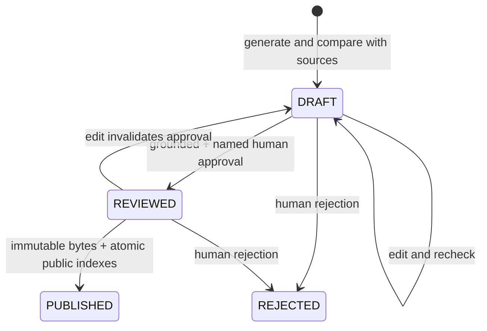

# Editorial workflow

## Automatic AI editor (production)

Daily operation no longer requires a human editor when `AUTO_PUBLISH_ENABLED=true`. Topic ranking, writing and source verification use `AZURE_OPENAI_DEPLOYMENT` (normally `gpt-4.1-mini`). A separate final chief-editor call uses `AZURE_OPENAI_EDITOR_DEPLOYMENT` (normally `gpt-4.1`, in the same OpenAI account). There is no fallback to the writing model. Model names are configurable; operators must select an actually stronger model for the editor deployment, not another alias for the same model.

The final editor rechecks the exact title, perex, article and evidence against full original source texts, then approves or rejects based on grounding, attribution, neutrality, context and readability. Unlike the writer's 10,000-character source excerpts, its context is not silently truncated; a total source body above 200,000 characters fails before the API call and remains unpublished. Publication requires passing deterministic checks, passing the first AI fact check, an unambiguous final approval with no unresolved issues, and no sensitive flag. Damaging allegations are excluded from automatic publication. Completed drafts that fail grounding or editorial review become `REJECTED`; no human action is needed to skip them. Timeouts, refusals, malformed responses and exhausted budgets leave drafts private for a later scheduled attempt. The editor does not rewrite or repeatedly regenerate rejected articles.

Approval passes through `DRAFT → REVIEWED → PUBLISHED`, with the same immutable content hash and atomic Table indexes as manual publication. A private `articles/reviews/{articleId}/{inputHash}.json` records the editor deployment, policy version, timestamp and decision. Its key binds the exact article, full original source records, model and policy. Restarting after a saved decision or interrupted publication reuses that decision without another paid call. Editing content or changing source inputs invalidates it. Public disclosure distinguishes AI approval from human approval; automatic articles explicitly say they were not reviewed by a human. Multiple AI checks still do not establish independent truth.

The final editor normally adds **one AI call per eligible article**, at most three for a day's three new drafts. All stages and retries share `MAX_AI_CALLS_PER_DAY` (recommended 16: up to four ranking batches, six generation/verification calls and three editor calls, with a small margin). Output and execution time remain bounded. A failed attempt also consumes a reservation. Usage pricing for the editor is configured separately with `EDITOR_INPUT_USD_PER_MILLION` / `EDITOR_OUTPUT_USD_PER_MILLION`; zero means unconfigured, not free.

The author writes each title/perex/paragraph once and selects an evidence-excerpt ID from the supplied originals. Application code attaches the exact original excerpt and constructs the article from the same text fields. This avoids drift between two copies of the prose and avoids transcription mistakes in quotations. Valid excerpt selection is not proof of support: numeric, quote, semantic verification and final editor checks still apply. Preliminary failures are attributed to `Automatic checks`; only an actual final-editor decision is attributed to `AI editor: MODEL`.

Local defaults and infrastructure leave automatic publication disabled until the stronger deployment is provisioned and the updated code is deployed. Follow [activation instructions](deployment.md#activate-the-automatic-ai-editor) once. After activation, the morning timer publishes accepted articles directly; frontend rebuilds are unnecessary for later articles. Set `AUTO_PUBLISH_ENABLED=false` to suspend automatic publication while retaining collection and draft generation.

## Optional manual recovery

No administrative HTTP endpoint is deployed. Use the local Java CLI as a trusted editor with Azure RBAC, or with Azurite for development. `scripts/editorial/editorial.ps1` compiles Java and builds a classpath on first use, loads ignored local settings, and invokes `Cli` directly without a shell-built command. Use `-SkipBuild` only after an unchanged successful build. Explicit environment values override local settings.

## Commands

```powershell
./scripts/editorial/editorial.ps1 init
./scripts/editorial/editorial.ps1 -SkipBuild collect
./scripts/editorial/editorial.ps1 -SkipBuild run
./scripts/editorial/editorial.ps1 -SkipBuild list
./scripts/editorial/editorial.ps1 -SkipBuild inspect ARTICLE_ID
New-Item -ItemType Directory -Force editorial-export | Out-Null
./scripts/editorial/editorial.ps1 -SkipBuild export ARTICLE_ID editorial-export/draft.json
# Edit the local JSON: title, perex, category, markdown, claims.
./scripts/editorial/editorial.ps1 -SkipBuild edit ARTICLE_ID editorial-export/draft.json
./scripts/editorial/editorial.ps1 -SkipBuild recheck ARTICLE_ID
./scripts/editorial/editorial.ps1 -SkipBuild approve ARTICLE_ID 'Human editor name'
./scripts/editorial/editorial.ps1 -SkipBuild publish ARTICLE_ID
# For damaging allegations, after assessing original evidence and attribution:
./scripts/editorial/editorial.ps1 -SkipBuild approve ARTICLE_ID 'Human editor name' --ack-sensitive
# Reject a completed or interrupted draft:
./scripts/editorial/editorial.ps1 -SkipBuild reject ARTICLE_ID 'Human editor name'
```

`run` with Azure AI can incur charges; `collect` and `check-feeds` do not call AI. An edit's `claims` must contain exact paragraph text, supplied release ID and exact source evidence; the title/perex also need entries. `inspect` prints full originals, evidence mappings, flags and article text. Do not paste private originals into public issue trackers. The local export directory is ignored.

## Decisions before approval

Read the draft and original sources, opening original URLs. Check names, dates, numbers, quotes, omissions and conclusions. Determine whether the source actually supports each statement and whether the article clearly attributes issuer claims. A press release is not independent proof of those claims. Review uncertainty and scope; MH SR currently supplies summaries, not full retrieved documents. Follow links to read complete originals where needed; updating article evidence with independent sources requires an explicitly implemented additional collector, not invented model references.

The model newsworthiness score ranks public interest, not truth. A passing AI check is not a human review. Sensitive flags are conservative and incomplete. Always assess allegations of corruption, crime, misconduct or reputational harm, even when the detector is false. The additional acknowledgement records a deliberate review step; it does not make an unsupported allegation publishable.

## States



Generated text starts as `DRAFT`. In automatic mode, completed failed checks are rejected and eligible drafts proceed to the final AI editor. In manual mode, failed checks remain drafts with explicit issues. A truncated/refused generation has internal `GENERATING`/`VERIFYING` phase and can resume or be rejected. It is never public. Rejected input material is consumed so a later run does not recreate the same story. Rejected/published articles are terminal in this MVP.

Approving requires a complete draft with passing semantic and deterministic checks. Edits reset approval/reviewer/hash, so the article must be rechecked and approved again. The approval hash includes title, perex, category, source URLs, evidence, model and Markdown. Publishing verifies that hash and reviewed metadata before writing an immutable private published Blob and committing canonical/public/slug rows together.

If publishing fails, readers cannot see a partially published article. Retry `publish` with the same ID; after a successful Table commit a repeated command returns successfully without another article. If a human changes underlying Storage outside the CLI, the hash checks or ETags reject ordinary mismatches; authorized Storage contributors are still trusted and can bypass application rules, which is why editor membership must remain narrow.

All articles show AI disclosure and source references under **Ako sme na to prišli**. No automatic independent verification is claimed. No synthetic fixture can be created/published through CLI to cloud Storage.
